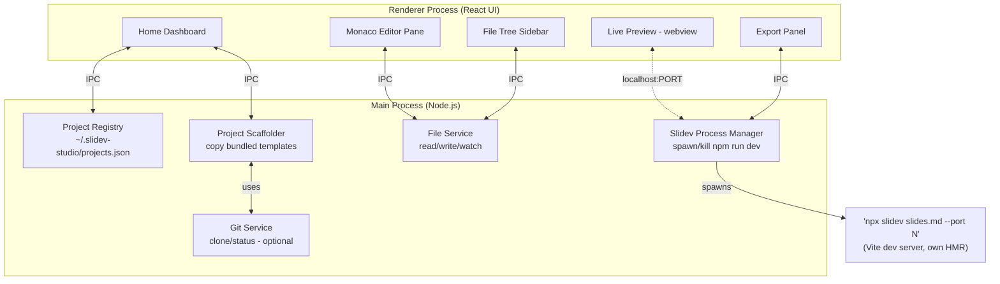

# Kế hoạch xây dựng **Slidev Studio** — Desktop App quản lý & live-edit Slidev

> Ứng dụng desktop cá nhân để: mở/chọn một Slidev repo có sẵn, tạo repo mới từ template, chỉnh sửa markdown ngay trong app với **live preview** (compile trực tiếp qua HMR của Slidev), tất cả gói gọn trong 1 màn hình chính — mở app lên là bấm vào chỉnh sửa được ngay.

Tài liệu này dựa trên 2 project Slidev thực tế bạn đang có (`KneeOsteo` — 1 file `slides.md`, theme `frankfurt`; `slidev-multi-theme` — nhiều file `slides-*.md` chạy song song trên nhiều port qua `concurrently`), nên các phần "multi-project", "multi-port", "multi-entry-file" được thiết kế sẵn chứ không phải chỉ hỗ trợ 1 file `slides.md` đơn giản.

---

## 1. Mục tiêu & phạm vi

| Yêu cầu bạn đưa ra | Module tương ứng |
|---|---|
| Có desktop app, dùng cá nhân | M1 — App Shell |
| Live preview, compile trực tiếp | M3 + M5 — Process Manager + Preview Pane |
| Sửa `.md` có preview ngay | M4 — Editor Pane |
| Màn hình chính, bấm vào là sửa được | M6 — Home Dashboard |
| Chọn được repo để chỉnh sửa | M2 — Project/Repo Manager |
| Tạo repo mới | M2 + M2b — New Project Wizard |
| "Ứng dụng hoàn chỉnh" | M7 Export, M8 Settings, đóng gói cài đặt (§13) |

**Không nằm trong scope MVP** (đánh dấu stretch goal ở Phase 6): đồng bộ cloud, đa người dùng, AI viết nội dung slide hộ, mobile companion app.

---

## 2. Kiến trúc tổng thể



**Ý tưởng cốt lõi**: Slidev đã tự có Vite dev-server với HMR cực nhanh. Thay vì tự viết engine render markdown → app **không** tự parse/preview markdown, mà chỉ:
1. Spawn tiến trình `slidev` cho đúng project đang mở.
2. Hiển thị `localhost:<port>` đó trong một `<webview>`.
3. Khi Editor ghi đè file `.md` xuống đĩa → Slidev tự nhận thay đổi → tự đẩy HMR → preview tự cập nhật.

App gần như đóng vai trò **"vỏ bọc" (shell) quản lý nhiều project + tiến trình + editor**, không phải viết lại renderer của Slidev. Cách này an toàn hơn nhiều, ít bug, và tương thích mọi theme/plugin Slidev có sẵn.

---

## 3. Lựa chọn công nghệ

| Tiêu chí | **Electron** (khuyến nghị) | Tauri |
|---|---|---|
| Spawn `npx slidev`, đọc/ghi file | Native — main process là Node.js, dùng thẳng `child_process`/`execa` | Phải viết qua Rust `std::process::Command`, thêm 1 lớp IPC Rust↔JS |
| Bundle sẵn Node runtime | Có thể đóng gói Node portable nếu muốn zero-setup | Không có Node sẵn, vẫn phải gọi Node hệ thống hoặc tự bundle |
| Hệ sinh thái npm cho editor (Monaco, xterm...) | Dùng trực tiếp | Dùng trực tiếp qua webview, nhưng ít ví dụ hơn |
| Kích thước app | ~150-200MB | ~15-30MB (nhẹ hơn nhiều) |
| Độ trưởng thành cho loại app "IDE mini" | Rất nhiều app tương tự (VS Code, Postman) dùng Electron | Có nhưng ít hơn |

→ **Chọn Electron**, vì bản chất app này là "điều phối tiến trình Node + hiển thị web preview" — đúng sở trường của Electron, giảm rủi ro kỹ thuật.

**Stack cụ thể:**
- **Shell**: Electron + `electron-vite` (dev nhanh, HMR cho chính app) + TypeScript
- **UI**: React + Tailwind CSS
- **Editor**: `@monaco-editor/react` (giống VS Code, hỗ trợ Markdown/YAML tốt)
- **Preview**: thẻ `<webview>` của Electron (cô lập process, không crash cả app nếu Slidev lỗi)
- **Quản lý tiến trình con**: `execa` (wrapper đẹp hơn `child_process` thuần)
- **Git (tuỳ chọn)**: `simple-git`
- **Đóng gói**: `electron-builder` → `.dmg` / `.exe` (NSIS) / `.AppImage`

---

## 4. Cấu trúc thư mục app (Slidev Studio, khác với các project Slidev của bạn)

```
slidev-studio/
├── electron/
│   ├── main.ts                 # entry point main process
│   ├── preload.ts               # contextBridge — expose API an toàn cho renderer
│   ├── ipc/
│   │   ├── projects.ipc.ts      # list/add/remove/open project
│   │   ├── process.ipc.ts       # start/stop/restart slidev dev server
│   │   ├── fs.ipc.ts            # read/write file, list tree
│   │   ├── scaffold.ipc.ts      # create new project từ template
│   │   └── export.ipc.ts        # build / export pdf-png-pptx
│   ├── services/
│   │   ├── projectStore.ts      # đọc/ghi ~/.slidev-studio/projects.json
│   │   ├── processManager.ts    # spawn/kill, port allocator, log buffer
│   │   ├── scaffolder.ts        # copy template + npm install
│   │   └── portFinder.ts
│   └── templates/               # BUNDLE SẴN trong app, không gọi `npm init slidev` tương tác
│       ├── default/
│       ├── seriph/
│       ├── frankfurt-academic/  # theo đúng style bạn hay dùng
│       └── bricks/
├── src/                          # renderer (React)
│   ├── main.tsx
│   ├── App.tsx
│   ├── pages/
│   │   ├── HomeDashboard.tsx
│   │   ├── ProjectWorkspace.tsx  # Editor + Preview split view
│   │   └── NewProjectWizard.tsx
│   ├── components/
│   │   ├── ProjectCard.tsx
│   │   ├── FileTree.tsx
│   │   ├── EditorPane.tsx
│   │   ├── PreviewPane.tsx
│   │   ├── ProcessConsole.tsx    # log stdout/stderr của slidev dev
│   │   └── ExportDialog.tsx
│   ├── store/                    # Zustand hoặc Redux Toolkit — state toàn app
│   └── ipc-client.ts             # wrapper gọi window.api.*
├── electron-builder.yml
└── package.json
```

---

## 5. Chi tiết từng module

### M1 — App Shell
- Cửa sổ chính Electron (`BrowserWindow`), menu bar (File > New/Open/Quit), xử lý đóng app phải **kill hết tiến trình `slidev` con** trước khi thoát (tránh port bị treo).
- `preload.ts` dùng `contextBridge.exposeInMainWorld('api', {...})` — renderer **không** được `require('child_process')` trực tiếp (bảo mật).

### M2 — Project/Repo Manager
- File đăng ký `~/.slidev-studio/projects.json`:
```json
{
  "projects": [
    {
      "id": "uuid-v4",
      "name": "KneeOsteo",
      "path": "/Users/you/MySlide/KneeOsteo",
      "entryFiles": ["slides.md"],
      "gitUrl": null,
      "lastOpenedAt": "2026-09-28T10:00:00Z",
      "preferredPort": 3030
    },
    {
      "id": "uuid-v4-2",
      "name": "slidev-multi-theme",
      "path": "/Users/you/MySlide/slidev-multi-theme",
      "entryFiles": ["slides-scholarly.md", "slides-academic.md", "slides-hep.md", "slides-neversink.md", "slides-purplin.md"],
      "gitUrl": null,
      "lastOpenedAt": "2026-09-20T09:00:00Z",
      "preferredPort": 3031
    }
  ],
  "settings": { "defaultWorkspaceDir": "~/SlidevProjects", "editorFontSize": 14, "themeMode": "system" }
}
```
- **"Mở thư mục có sẵn"**: dialog chọn folder (native `dialog.showOpenDialog`) → validate: có `package.json` chứa dependency `@slidev/cli`, hoặc có file `*.md` với frontmatter Slidev → tự dò tất cả file `.md` ở root làm `entryFiles` (xử lý đúng case nhiều entry như `slidev-multi-theme`).
- **"Clone từ Git"**: nhập URL → `git clone <url> <workspaceDir>/<repo-name>` → validate như trên → thêm vào registry.
- **Xoá khỏi danh sách** vs **xoá hẳn thư mục** — 2 hành động khác nhau, phải confirm dialog riêng.

### M2b — New Project Wizard (tạo repo mới)
> **Quyết định thiết kế quan trọng**: `npm init slidev` là lệnh **tương tác** (hỏi tên, theme...) trên terminal thật — tự động hoá nó bằng cách giả lập bàn phím rất dễ vỡ (brittle) khi Slidev đổi câu hỏi ở version mới. Thay vào đó, **app tự bundle sẵn vài template Slidev tối giản** (đã `npm install` xong hoặc có `package.json` sẵn) trong thư mục `electron/templates/`, và "tạo project mới" = copy template + thay `title`/`author` trong frontmatter + `npm install`. Cách này ổn định 100%, không phụ thuộc CLI tương tác của bên thứ ba.
- Wizard 3 bước: (1) Tên project + vị trí lưu → (2) Chọn theme (preview ảnh tĩnh từng theme) → (3) Điền title/author/date → bấm "Tạo" → copy template → chạy `npm install` (log tiến trình) → tự thêm vào registry → mở thẳng vào Workspace.

### M3 — Slidev Process Manager
- Với mỗi `entryFile` đang mở: `execa('npx', ['slidev', entryFile, '--port', String(port)], { cwd: project.path })`.
- **Port allocator**: thử `preferredPort`, nếu bận thì dò cổng trống kế tiếp (dùng package `get-port`), tránh đúng lỗi hardcode port từng thấy trong `slidev-multi-theme/package.json`.
- Theo dõi stdout tìm dòng `"ready"`/URL `http://localhost:`  → bắn event `slidev:ready` cho renderer để chuyển `<webview>` sang URL đó.
- Trạng thái tiến trình: `idle | installing | starting | running | error | stopped` — hiển thị badge trên tab.
- Nếu `node_modules` chưa có → tự hỏi "Cài dependencies?" → chạy `npm install` trước, có thanh log riêng (Console panel).
- **Cleanup**: lưu danh sách PID đang chạy, `app.on('before-quit')` và `app.on('window-all-closed')` phải kill hết (kể cả kill theo process-group trên Windows/macOS khác nhau — dùng `tree-kill` package để chắc chắn diệt cả process con của `npx`).

### M4 — Editor Pane
- Monaco Editor, ngôn ngữ `markdown`, load nội dung file qua IPC `fs:readFile`.
- **Autosave debounce 600ms** sau khi ngừng gõ → `fs:writeFile` → Slidev tự HMR, preview tự cập nhật, **không cần app tự refresh webview**.
- Có nút Save thủ công (Ctrl/Cmd+S) phòng khi tắt autosave.
- Cảnh báo "chưa lưu" nếu người dùng đổi file khác/đóng tab mà còn thay đổi chưa ghi (trường hợp autosave đang tắt).

### M5 — Live Preview Pane
- `<webview src={devServerUrl} />` — set `webpreferences="contextIsolation=yes"` cho webview để cô lập.
- Toolbar nhỏ: Refresh, "Mở trình duyệt ngoài", nút chuyển slide trước/sau (gửi phím mũi tên vào webview qua `webview.sendInputEvent`), toggle chế độ Presenter (mở link `?mode=presenter` — Slidev hỗ trợ sẵn).
- Vì HMR do Vite/Slidev tự lo, **không cần** tự viết logic reload — chỉ cần lắng nghe khi cổng đổi (project restart) để set lại `src`.

### M6 — Home Dashboard (màn hình chính)
- Lưới thẻ `ProjectCard` cho từng project đã đăng ký: tên, đường dẫn rút gọn, "mở lần cuối", số entry file.
- Click vào thẻ → mở thẳng Workspace, tự start dev server nếu chưa chạy.
- 3 nút nổi bật: **"Mở thư mục có sẵn"**, **"Tạo project mới"**, **"Clone từ Git"**.
- Ô tìm kiếm lọc theo tên khi danh sách dài.
- Trạng thái rỗng (lần đầu mở app): hiển thị 3 CTA to, hướng dẫn ngắn.

### M7 — Export / Build Panel
- Trong Workspace, tab "Export": các nút gọi `slidev build` (build static site) và `slidev export --format pdf|png|pptx` (Slidev hỗ trợ sẵn cả 3 format này).
- Hiển thị log tiến trình build/export trong Console panel (dùng chung component với M3).
- Xong thì hiện nút "Mở thư mục chứa file" (`shell.showItemInFolder`).

### M8 — Settings
- Cỡ chữ editor, light/dark/theo hệ thống, thư mục workspace mặc định cho project mới, đường dẫn Node/npm thủ công (fallback khi app không tự tìm thấy `node` trong PATH — hay gặp trên macOS khi mở app không qua terminal).

### M9 — Git tích hợp *(stretch goal, không bắt buộc MVP)*
- Hiển thị branch hiện tại + số file thay đổi (dùng `simple-git`), nút Commit & Push nhanh. Không cần thiết để app "dùng được", để Phase 6.

---

## 6. Luồng người dùng (end-to-end)

1. Mở app → **Home Dashboard** hiện danh sách project (hoặc empty state lần đầu).
2. Bấm **"Mở thư mục có sẵn"** → chọn `KneeOsteo` → app validate, thêm vào registry.
3. Tự động vào **Workspace**: nếu chưa có `node_modules` → hỏi cài đặt → chạy `npm install` (có log) → sau đó tự `npx slidev slides.md --port 3030`.
4. Khi thấy dòng "ready" trong log → `<webview>` load `http://localhost:3030`.
5. Người dùng gõ trong **Editor** (trái) → autosave 600ms → Slidev tự HMR → **Preview** (phải) tự cập nhật ngay, không cần bấm gì thêm.
6. Muốn sửa file khác (vd `components/Counter.vue`) → chọn trong **File Tree** → Editor load file đó.
7. Xong bài → tab **Export** → chọn "Xuất PDF" → chờ log chạy xong → "Mở thư mục chứa file".
8. Quay lại Home → bấm **"Tạo project mới"** → wizard 3 bước → project mới tự mở vào Workspace.
9. Đóng app → toàn bộ tiến trình `slidev` con bị kill sạch, không rác port.

---

## 7. Kế hoạch triển khai theo Phase

| Phase | Nội dung | Module | Ước lượng |
|---|---|---|---|
| 0 | Scaffold Electron + Vite + React + TS, cấu hình `electron-builder`, IPC bridge rỗng | M1 | 0.5 ngày |
| 1 | MVP đọc-xem: mở folder có sẵn, spawn dev server, hiện preview (chưa có editor trong app) | M2 (rút gọn), M3, M5 | 1–2 ngày |
| 2 | Gắn Monaco Editor, autosave, file tree đa file | M4 | 2–3 ngày |
| 3 | Project Registry bền vững (JSON), Home Dashboard, multi-tab nhiều project cùng lúc, Clone Git | M2 đầy đủ, M6 | 2 ngày |
| 4 | New Project Wizard + bundle template | M2b | 1–2 ngày |
| 5 | Export panel, Settings, xử lý lỗi/loading, đóng gói cài đặt | M7, M8, §13 | 1–2 ngày |
| 6 *(tuỳ chọn)* | Git status/commit, thumbnail ảnh bìa slide, auto-update | M9 | mở rộng sau |

---

## 8. Prompt chi tiết cho AI (dùng trực tiếp với Claude Code hoặc công cụ coding-agent khác)

> Dán từng prompt theo đúng thứ tự Phase. Mỗi prompt đã có ngữ cảnh + tiêu chí hoàn thành, để AI code từng phase độc lập, dễ review.

### 🔹 Prompt Phase 0 — Khởi tạo dự án

```
Tôi muốn tạo một Electron desktop app tên "Slidev Studio" bằng electron-vite + React + TypeScript + Tailwind CSS.

Yêu cầu:
1. Scaffold project bằng electron-vite (template react-ts).
2. Cấu trúc thư mục theo đúng layout sau (tạo các thư mục rỗng có file .gitkeep nếu chưa có nội dung):
   electron/main.ts, electron/preload.ts, electron/ipc/, electron/services/, electron/templates/
   src/pages/, src/components/, src/store/, src/ipc-client.ts
3. Trong electron/preload.ts, dùng contextBridge.exposeInMainWorld('api', {...}) làm bộ khung rỗng
   để sau này expose các hàm: projects.list/add/remove, process.start/stop/restart,
   fs.readFile/writeFile/listTree, scaffold.create, export.run — chỉ cần khai báo type/signature,
   thân hàm để throw new Error('not implemented') tạm thời.
4. Cấu hình electron-builder.yml build được cho macOS (dmg), Windows (nsis), Linux (AppImage).
5. Setup Tailwind CSS cho renderer (src/).
6. Thêm React Router (hoặc tự viết router state đơn giản) với 2 route placeholder:
   "/" -> HomeDashboard, "/workspace/:projectId" -> ProjectWorkspace.

Tiêu chí hoàn thành: `npm run dev` mở được cửa sổ Electron, hiện trang Home rỗng, không lỗi console.
```

### 🔹 Prompt Phase 1 — MVP mở project & live preview (đọc-xem)

```
Bối cảnh: app Electron "Slidev Studio" đã scaffold xong (xem electron/, src/).
Slidev là công cụ dựng slide bằng markdown, chạy dev server qua lệnh:
`npx slidev <entryFile> --port <port>` (spawn trong đúng thư mục project), nó tự có
hot-reload riêng — app KHÔNG cần tự viết logic reload, chỉ cần hiển thị URL dev server đó.

Nhiệm vụ — implement Phase 1 (MVP đọc-xem, chưa cần Editor):
1. electron/services/portFinder.ts: hàm findFreePort(preferred: number): Promise<number>
   dùng package "get-port", nếu preferred bận thì trả về port trống kế tiếp.
2. electron/services/processManager.ts: dùng package "execa" để spawn
   `npx slidev <entryFile> --port <port>` trong cwd = project.path.
   - Bắt stdout, phát event khi thấy dòng chứa "ready" hoặc URL "http://localhost:"
     kèm port thực tế đã chạy.
   - Lưu map projectId -> { process, port, status }, status thuộc
     'starting' | 'running' | 'error' | 'stopped'.
   - Hàm stop(projectId): kill process bằng package "tree-kill" (diệt cả process con,
     vì npx có thể spawn thêm 1 tiến trình node con).
   - Trong electron/main.ts, đăng ký app.on('before-quit') và
     app.on('window-all-closed') để kill tất cả process đang chạy trước khi thoát.
3. electron/ipc/process.ipc.ts: expose qua IPC:
   - process:start (projectPath, entryFile, preferredPort) -> trả về { port, status }
   - process:stop (projectId)
   - lắng nghe/emit sự kiện process:status-changed và process:log (mỗi dòng stdout/stderr)
     gửi về renderer qua webContents.send.
4. Trong preload.ts, bổ sung đúng các hàm trên vào window.api.process.
5. src/pages/ProjectWorkspace.tsx: khi mount, gọi api.process.start(...), hiển thị:
   - Nếu status = starting: loading spinner + log console (list các dòng process:log nhận được).
   - Nếu status = running: hiện <webview src={`http://localhost:${port}`} />
     (bật webpreferences allowpopups, đặt trong 1 div flex-1 chiếm phần bên phải màn hình,
      bên trái để trống — sẽ làm Editor ở Phase 2).
   - Nếu status = error: hiện log lỗi + nút "Thử lại".
6. Hard-code tạm 1 project test (path do người dùng nhập vào 1 input text ở Home, entryFile
   mặc định "slides.md") để test luồng — Phase 3 mới làm registry thật.

Tiêu chí hoàn thành: nhập đường dẫn 1 project Slidev thật có sẵn (đã npm install) + tên file
markdown, app spawn được dev server, webview hiện đúng slide, đóng app không để lại
tiến trình node/slidev nào chạy ngầm (kiểm tra bằng Activity Monitor / Task Manager).
```

### 🔹 Prompt Phase 2 — Tích hợp Monaco Editor + autosave

```
Bối cảnh: Phase 1 đã xong — app spawn được Slidev dev server và hiện live preview qua webview.
Giờ cần thêm Editor để sửa file .md ngay trong app, đồng thời hiện File Tree cho project
có nhiều file (có project chỉ có 1 file slides.md, có project có nhiều file slides-*.md
ở root + components/*.vue + pages/*.md).

Nhiệm vụ:
1. electron/ipc/fs.ipc.ts, expose:
   - fs:readFile(path) -> string
   - fs:writeFile(path, content) -> void
   - fs:listTree(rootPath) -> cây thư mục dạng { name, path, isDirectory, children? },
     bỏ qua node_modules, .git, dist.
2. Cài "@monaco-editor/react". Tạo src/components/EditorPane.tsx:
   - props: filePath, onDirtyChange
   - load nội dung ban đầu bằng api.fs.readFile
   - onChange: debounce 600ms rồi tự động gọi api.fs.writeFile (không cần người dùng bấm gì)
   - Ctrl/Cmd+S: lưu ngay lập tức, bỏ qua debounce
   - hiện chấm tròn nhỏ cạnh tên file nếu đang có thay đổi chưa ghi (dirty state)
   - ngôn ngữ Monaco = "markdown"
3. Tạo src/components/FileTree.tsx: hiện cây thư mục từ api.fs.listTree, click 1 file .md
   hoặc .vue thì set làm activeFile cho EditorPane. Đánh dấu icon khác nhau cho .md/.vue/folder.
4. Cập nhật ProjectWorkspace.tsx thành layout 3 cột:
   [FileTree 200px] [EditorPane flex-1] [PreviewPane flex-1]
   mặc định activeFile = entryFile của project.
5. KHÔNG cần viết logic tự refresh webview khi file thay đổi — Slidev tự HMR khi
   fs:writeFile ghi xuống đĩa, webview sẽ tự cập nhật.

Tiêu chí hoàn thành: gõ trong Editor, sau ~0.6s không gõ nữa, preview bên phải tự đổi theo
mà không cần reload thủ công. Chuyển file trong File Tree, Editor load đúng nội dung file đó.
```

### 🔹 Prompt Phase 3 — Project Registry + Home Dashboard + đa project

```
Bối cảnh: Editor + Preview trong 1 project đã hoạt động tốt (Phase 1-2). Giờ cần màn hình
chính quản lý NHIỀU project (chọn project có sẵn, xoá khỏi danh sách, clone từ git), và
cho phép mở nhiều project cùng lúc ở các tab khác nhau (mỗi project 1 port riêng).

Nhiệm vụ:
1. electron/services/projectStore.ts: đọc/ghi file JSON tại
   app.getPath('userData') + '/projects.json' với schema:
   { projects: [{ id, name, path, entryFiles: string[], gitUrl, lastOpenedAt, preferredPort }],
     settings: { defaultWorkspaceDir, editorFontSize, themeMode } }
   Dùng uuid cho id. Nếu file chưa tồn tại thì tạo mới với projects rỗng.
2. Hàm addProjectFromFolder(folderPath): validate có package.json chứa "@slidev/cli"
   trong dependencies/devDependencies HOẶC có ít nhất 1 file .md ở root chứa frontmatter
   Slidev (bắt đầu bằng "---" và có key "theme" hoặc "layout"); tự liệt kê hết các file .md
   ở root làm entryFiles (xử lý đúng case nhiều entry file như slidev-multi-theme).
   Nếu không hợp lệ, trả lỗi rõ ràng để hiện toast cho người dùng.
3. electron/ipc/projects.ipc.ts: expose projects:list, projects:addFolder(path),
   projects:remove(id), projects:cloneFromGit(url, targetDir).
   cloneFromGit dùng execa gọi "git clone <url> <targetDir>" (yêu cầu git đã cài trên máy;
   nếu lệnh git không tồn tại, trả lỗi thân thiện "Chưa cài Git, vui lòng cài đặt trước").
4. src/pages/HomeDashboard.tsx:
   - Lưới ProjectCard (tên, path rút gọn, lastOpenedAt định dạng "x giờ trước")
   - 3 nút nổi bật: "Mở thư mục có sẵn" (dialog.showOpenDialog qua IPC),
     "Tạo project mới" (điều hướng sang NewProjectWizard - để Phase 4),
     "Clone từ Git" (mở modal nhập URL + chọn thư mục đích)
   - Ô search lọc theo tên
   - Click card -> điều hướng sang /workspace/:projectId
5. Cho phép mở nhiều project cùng lúc: dùng tab bar phía trên ProjectWorkspace (mỗi tab
   = 1 project đang chạy dev server riêng với port riêng). Đóng tab -> gọi process:stop
   cho đúng project đó, không ảnh hưởng project khác.

Tiêu chí hoàn thành: mở lại app sau khi tắt, danh sách project vẫn còn (đã lưu JSON).
Mở được 2 project cùng lúc ở 2 tab, mỗi tab preview đúng port của project đó, đóng 1 tab
không làm tắt project còn lại.
```

### 🔹 Prompt Phase 4 — New Project Wizard (tạo repo mới, không dùng CLI tương tác)

```
Bối cảnh: `npm init slidev` là lệnh tương tác qua terminal (hỏi tên/theme từng bước), rất
khó tự động hoá ổn định. Giải pháp: bundle sẵn vài template Slidev tối giản ngay trong app
(thư mục electron/templates/<theme-name>/), "tạo project mới" = copy template ra thư mục
đích + sửa vài field trong frontmatter + chạy npm install.

Nhiệm vụ:
1. Tạo electron/templates/default/ và electron/templates/seriph/ — mỗi thư mục là 1 project
   Slidev tối giản hợp lệ: package.json (dependencies: @slidev/cli, @slidev/theme-<tên>, vue),
   slides.md với frontmatter { theme: <tên>, title: '{{TITLE}}', author: '{{AUTHOR}}' } và
   2-3 slide mẫu, thư mục public/ trống, .gitignore chuẩn (node_modules, dist, .DS_Store).
2. electron/services/scaffolder.ts, hàm createProject({ name, targetDir, templateId, title, author }):
   - copy toàn bộ thư mục template sang targetDir/name (dùng "fs-extra" copy, loại trừ node_modules
     nếu có trong template)
   - đọc slides.md, thay thế các placeholder {{TITLE}} -> title, {{AUTHOR}} -> author
   - sửa "name" trong package.json = slug hoá từ `name`
   - chạy "npm install" trong thư mục mới (execa, stream log qua event scaffold:log)
   - trả về path project mới để tự động add vào projectStore (Phase 3) và mở Workspace
3. electron/ipc/scaffold.ipc.ts: expose scaffold:listTemplates() (đọc tên thư mục trong
   electron/templates/), scaffold:create(options).
4. src/pages/NewProjectWizard.tsx — 3 bước dạng stepper:
   Bước 1: input Tên project + nút chọn thư mục lưu (mặc định = settings.defaultWorkspaceDir)
   Bước 2: chọn 1 trong các template (hiện tên + mô tả ngắn, load qua scaffold:listTemplates)
   Bước 3: input Title + Author (điền sẵn Author lần trước nếu có lưu trong settings)
   Nút "Tạo project": gọi scaffold:create, hiện log cài đặt npm install real-time, xong thì
   tự điều hướng sang /workspace/:newProjectId.

Tiêu chí hoàn thành: từ Home bấm "Tạo project mới", đi hết 3 bước, ra 1 project Slidev
chạy được ngay (npm run dev thành công), đã tự mở vào Workspace với preview hiện đúng
title/author vừa nhập.
```

### 🔹 Prompt Phase 5 — Export, Settings, đóng gói

```
Bối cảnh: các luồng chính (mở project, sửa, preview, tạo mới) đã hoàn chỉnh. Giờ hoàn thiện
tính năng xuất file, trang cài đặt, và cấu hình đóng gói cài đặt phân phối được.

Nhiệm vụ:
1. electron/ipc/export.ipc.ts: expose export:run(projectPath, entryFile, format) với
   format thuộc 'pdf' | 'png' | 'pptx' | 'build' (build = `slidev build <entryFile>`,
   còn lại = `slidev export <entryFile> --format <format>`), spawn qua execa trong
   cwd = projectPath, stream log qua export:log, khi xong trả về đường dẫn file/thư mục
   output (Slidev mặc định xuất ra thư mục export/ hoặc dist/ — đọc log để bắt đúng path,
   hoặc set --output tường minh khi gọi lệnh).
2. src/components/ExportDialog.tsx trong ProjectWorkspace: chọn định dạng, nút "Xuất",
   hiện log tiến trình (tái dùng component Console đã có ở Phase 1), xong hiện nút
   "Mở thư mục chứa file" (gọi shell.showItemInFolder qua 1 IPC mới shell:showInFolder).
3. src/pages/SettingsPage.tsx: form chỉnh settings.editorFontSize, settings.themeMode
   (light/dark/system — áp dụng class Tailwind dark: ngay), settings.defaultWorkspaceDir,
   và 1 field "Node/npm path override" (optional, lưu vào settings, processManager ưu tiên
   dùng path này nếu có thay vì PATH hệ thống — xử lý case macOS app mở không qua terminal
   không thấy PATH đầy đủ).
4. electron-builder.yml hoàn chỉnh: appId, productName "Slidev Studio", icon cho 3 platform,
   target mac: dmg, win: nsis, linux: AppImage. Thêm script "npm run dist" build cả 3.
5. Thêm xử lý lỗi toàn cục: nếu spawn 'npx slidev' báo lỗi "command not found" (chưa cài
   Node.js) -> hiện màn hình hướng dẫn cài Node.js kèm link nodejs.org, không để app
   crash trắng màn hình.

Tiêu chí hoàn thành: xuất được PDF từ 1 project thật, mở đúng file trong Finder/Explorer.
Đổi theme light/dark hoạt động. `npm run dist` ra được file cài đặt chạy thử được trên
máy hiện tại của bạn.
```

---

## 9. Rủi ro kỹ thuật cần lưu ý

1. **Node.js phải có sẵn trên máy** — Electron chỉ tự mang Node cho *chính app*, không tự có Node CLI để chạy `npm install`/`npx slidev` cho project của người dùng. MVP nên yêu cầu người dùng đã cài Node.js (đằng nào bạn cũng đang tự chạy `npm run dev` cho Slidev rồi, nên máy chắc chắn đã có Node). Zero-setup thật sự (tự bundle Node runtime ~80-150MB) để dành Phase 6+ nếu cần phân phối cho người không rành kỹ thuật.
2. **macOS PATH khi mở app qua double-click** — app launch không qua terminal có thể không thấy `node`/`npm` trong PATH dù terminal thấy được. Cần dò thêm các path phổ biến (`/usr/local/bin`, `/opt/homebrew/bin`, `~/.nvm/versions/node/*/bin`) hoặc dùng package `fix-path`/`shell-env`.
3. **Kill tiến trình con triệt để** — `npx slidev` có thể spawn thêm 1 tiến trình `node` con (esbuild/vite cũng có thể có worker riêng); chỉ `process.kill()` trên PID gốc có thể để sót. Bắt buộc dùng `tree-kill` hoặc spawn với `detached: false` + kill theo process group.
4. **Đụng port** — nhiều project mở cùng lúc, hoặc project cũ dùng hardcode port (như `slidev-multi-theme` đang có sẵn `--port 3031..3035` trong script) dễ trùng port khi app tự chọn. Port allocator (M3) phải luôn dò cổng trống thực tế, không tin tưởng tuyệt đối `preferredPort` lưu trong registry.
5. **`<webview>` vs `<iframe>`** — Electron khuyến nghị hạn chế dùng `<webview>` (có thể bị deprecate dần); phương án thay thế ổn định hơn là `BrowserView`/`WebContentsView` gắn vào đúng vùng toạ độ trong cửa sổ chính. Phase 1 có thể bắt đầu bằng `<webview>` cho nhanh, nhưng nên note lại để cân nhắc chuyển sang `WebContentsView` khi ổn định sản phẩm.
6. **Slidev tự đổi port nếu bận** — nếu Slidev thấy `--port` truyền vào đang bận, chính nó cũng có thể tự nhảy sang port khác và log ra port thực tế — vì vậy processManager phải **đọc port thật từ log/stdout**, không giả định port truyền vào chắc chắn là port cuối cùng.

---

## 10. Checklist kiểm thử trước khi coi là "xong"

- [ ] Mở project chỉ có 1 file `slides.md` (như `KneeOsteo`) — preview đúng theme `frankfurt`.
- [ ] Mở project nhiều entry file (như `slidev-multi-theme`) — chọn đúng từng file, mỗi file chạy port riêng không đụng nhau.
- [ ] Sửa markdown, không bấm gì thêm, preview tự cập nhật trong <1 giây.
- [ ] Sửa 1 component `.vue` trong `components/` — HMR vẫn hoạt động qua Slidev.
- [ ] Tạo project mới từ wizard, `npm install` chạy xong không lỗi, mở preview được ngay.
- [ ] Clone 1 repo Git Slidev công khai bất kỳ, mở & chạy được.
- [ ] Mở 3 project cùng lúc ở 3 tab, đóng 1 tab không ảnh hưởng 2 tab còn lại.
- [ ] Xuất PDF và PPTX thành công, file mở được đúng nội dung.
- [ ] Tắt app đột ngột (Cmd+Q / Alt+F4) → kiểm tra Activity Monitor/Task Manager không còn tiến trình `node`/`slidev` mồ côi.
- [ ] Test trên máy **chưa cài Node.js** → app hiện hướng dẫn cài đặt rõ ràng, không crash câm lặng.

---

## 11. Đóng gói & phân phối

- Dùng `electron-builder` (`npm run dist`) build ra:
  - macOS: `.dmg` (cần code-sign + notarize nếu muốn tránh cảnh báo Gatekeeper — có thể bỏ qua ở bản dùng cá nhân, chạy "Open Anyway" trong System Settings).
  - Windows: `.exe` (NSIS installer).
  - Linux: `.AppImage`.
- Vì là app dùng cá nhân, có thể bỏ qua auto-update (`electron-updater`) ở bản đầu, thêm sau nếu cần.
- Icon app: dùng chính logo trong `KneeOsteo/public/images/logo.png` làm nguồn resize ra `icon.icns`/`icon.ico`/`icon.png` cho đồng bộ thương hiệu cá nhân, nếu muốn.

---

## 12. Tóm tắt lộ trình nhanh

```mermaid
gantt
    dateFormat  X
    axisFormat %d
    section Slidev Studio
    Phase 0 Setup           :0, 1
    Phase 1 MVP preview     :1, 2
    Phase 2 Editor          :3, 3
    Phase 3 Registry+Home   :6, 2
    Phase 4 New Project     :8, 2
    Phase 5 Export+Package  :10, 2
```



Tổng thời gian ước tính cho 1 người làm part-time: **~8–12 ngày công** để có bản dùng ổn định hàng ngày (Phase 0-5). Phase 6 (Git, thumbnail, auto-update) làm dần sau khi đã dùng quen.
